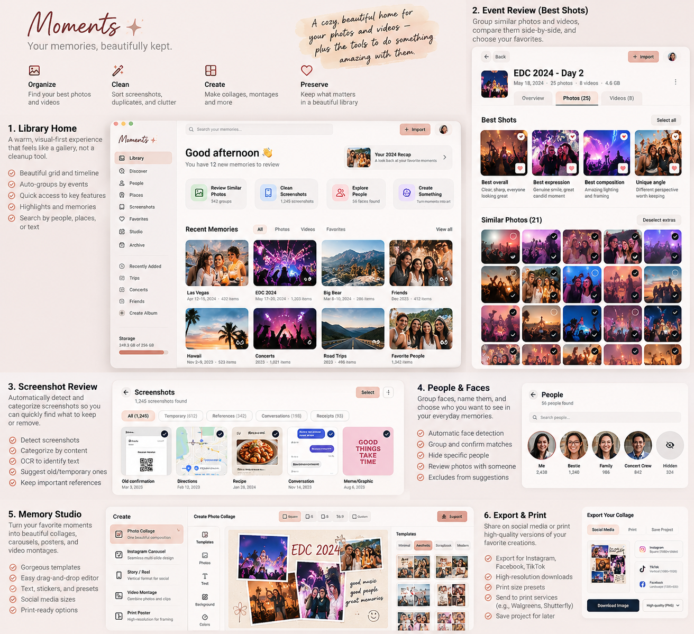

# Nearmora — MVP Product Blueprint

Version 0.1 · Revised product proposal · October 28, 2026

**Working name: Nearmora. No legal clearance is established by this blueprint.**

## 1. Product foundation

**Category:** Personal memory management and creative studio.

**Mission:** Help people rediscover, organize, preserve, and create something beautiful from the memories they've captured.

**Tagline:** Keep the feeling close.

**Development purpose:** Build a real consumer product while developing the owner's engineering skills. Record personally completed work and measured results honestly; do not treat planned technologies as acquired skills. The supplied [Technical Stack & Professional Development Requirements](Nearmora-Technical-Requirements-Source.md) are preserved verbatim alongside this blueprint and incorporated in Section 13.

**Promise:** Nearmora starts by helping you find what you love. People decide what matters; technology helps them find it. Organizing should feel approachable, and originals must remain protected.

The first audience is someone with many variations of meaningful photos across computer folders and external drives, who hesitates to choose because every version might matter someday. The central job is: “Help me find my favorites, keep my options, and turn a few memories into something I want to share.”

This document follows the supplied Nearmora foundation. Earlier conversation confirms emotional attachment, repeated shots, external-drive collections, and interest in future video and creative tools. Older assistant replies were returned as unavailable content references; their claims and name research are not treated as verified. Everything below beyond the supplied foundation is a proposed implementation decision.

**V0.1 loop:** Add a folder → browse memories → compare similar photos → choose favorites → create a small collage or carousel → export copies.

Differentiation to validate: a reassuring gallery with an immediate creative reward, rather than a cleanup score. This is a product hypothesis, not a claim that no competitor offers these features. Avoid storage-saved counters, streaks, urgency, automatic resurfacing, and “bad photo” judgments. Remember the last library view instead of surprising users with anniversary memories.

## 2. Scope and boundaries

| Area | Included in 0.1 | Deliberately excluded |
|---|---|---|
| Library | User-selected local folders and mounted drives; reference originals; JPEG and PNG; EXIF orientation; dates with visible fallback; search filename, title, folder; date/source/favorite filters | Cloud libraries, mobile import, managed Photos libraries, RAW, HEIC, animated media and video decoding |
| Discover | Exact-file hashes; candidate similar-photo groups using capture-time windows and perceptual similarity; manual remove/ungroup; side-by-side comparison | Face recognition, OCR/screenshot classification, semantic search, aesthetic or emotional ranking |
| Favorites | Zero, one or several favorites per group; decide later; persistent choices; undo | Picking a mandatory single winner, automatic rejection, file deletion |
| Studio Lite | Two fixed collage templates (two-up and four-cell), 1:1 or 4:5 canvas; ordered carousel of 2–10 individual slides; reorder, crop position, zoom, cream/white background; saved drafts | Freeform editor, filters, retouching, text tools, video montage, panoramas, print ordering |
| Export | JPEG/PNG collage or numbered carousel files; output preview, dimensions and destination; metadata stripped from rendered outputs | Direct social posting, accounts, scheduling, printer/third-party integrations |
| Preservation | Read-only original access; local catalog; catalog backup and restore; source reconnect | Cloud backup, moving/renaming originals, disk cleanup, physical “Archive extras” |

Video remains an important later direction because it was a core original motivation. V0.1 reports skipped videos clearly and never suggests they were reviewed. Validate the photo loop first, then explore basic video playback and manual favorites before sophisticated video comparison.

“Archive extras,” discussed earlier, is deferred as a file operation. In 0.1, unchosen photos remain in the library. Do not label a catalog flag as archival or backup. A later reversible hide/set-aside view can be considered after testing the wording.

**Proposed first target:** macOS desktop beta, because it is the current working environment; Windows follows a separate platform test gate. No claim of cross-platform readiness until packaged builds pass on each OS. Marketing website and pricing experiments follow the desktop prototype; no backend is needed for the core beta.

## 3. User journeys

### First meaningful session

1. A calm empty library explains: “Choose a folder to get started. Your originals stay where they are.” Add folder opens the OS picker. Offer an explicit fictional demo library separately.
2. Show chosen source, supported formats and thumbnail storage explanation before scanning. Import means indexing references, not copying a backup.
3. Scan progressively. Display discovered/indexed/skipped/error counts, with pause/cancel. The user can browse completed thumbnails while work continues.
4. Group photos into date-based moments. Default titles come from date/folder, not invented interpretations. Users can rename a moment and pick its cover; evocative sample titles in mockups are fictional user edits.
5. Open a candidate set, compare, select any favorites, save choices, and return to the same gallery position.

### Review without pressure

Open Best Moments → choose a set → compare two images → navigate remaining thumbnails → mark several favorites if desired. “Favorite all” marks every photo; “Decide later” preserves the undecided state. Save commits the set's choices atomically. Show “Saved” and Undo. A set may be marked reviewed with no favorites; review status and favorite status are separate.

Do not silently discard unsaved changes on navigation: offer Save, Discard changes, or Continue reviewing. Manual choices survive rescans and regrouping. Similarity means “possibly related,” never “safe to delete.” Date-only neighbors can be browsed as a moment but must not be presented as visually similar without similarity evidence.

### Make something worth sharing

Favorites → select 2 or 4 for a collage, or 2–10 for a carousel → Memory Studio → choose layout and aspect ratio → reorder and adjust crops → preview every output → choose destination → export. Keep the draft after export. Explain that export creates new files and does not publish anything. Export format/dimensions remain visible.

### Come back after a drive disconnects

Show “Source disconnected” and cached previews with an offline badge. Choices and drafts remain editable; full-resolution export is unavailable until sources reconnect. Reconnect checks source identity and file fingerprints. Never attach saved choices to a different file merely because its name matches. Missing or changed files get a relink/verify flow; users can cancel without losing their catalog.

## 4. Screens and interaction contract

Navigation: **Library · Best Moments · Favorites · Memory Studio · Sources**, with Settings below. Export is a Studio step, not a permanent top-level destination.

**Library Home:** A welcoming heading, Add folder, restrained search/filter controls, one user-controlled featured moment, and large photo-led cards. Show source status unobtrusively. No forced discovery carousel. Empty, scanning, partial, no-results, permission-denied and disconnected states all need dedicated copy and a next action.

**Best Moments Review:** Context and set position, large paired photos, selection labels, thumbnail navigation, and a stable action bar. Favorite is a heart plus a text label and selected outline; never color alone. No numeric quality score. At narrow widths switch to one image with A/B tabs while preserving selection and focus. Use fit-to-image preview by default; zoom/pan for detail without distorting either image. Two photos can both be favorites.

**Memory Studio:** Saved projects, template picker, bounded canvas, selected-photo tray and output preview. Missing originals block export with the exact affected items. A project stores references and crop transforms, not destructive photo edits.

**Sources:** Source path and status, rescan, reconnect, remove from catalog. Removing a source removes its catalog references only after a clear impact review; explain affected drafts. Never offer to delete the source files.

The two supplied PNGs are original visual concepts with synthetic sample photography, not functioning software or evidence of accessibility. Blueprint behavior takes precedence over generated wording or spacing.

## 5. Visual and accessibility system

| Token | Proposed use |
|---|---|
| Cream `#F8F0E8` | Primary surfaces |
| Plum `#5B414B` | Body text, headings, primary buttons with cream labels |
| Blush `#E8B7B0` | Selected navigation and gentle highlights |
| Lilac `#B9A4C8` | Decorative accents; pair focus treatment with a darker outline |
| Sage `#B8BDA6` | Favorite backgrounds with plum labels |

These are starting colors, not finalized brand standards. Verify every actual text/control combination; pastel fills are not automatically accessible. Use a locally bundled, license-checked expressive serif for headings and readable sans-serif for controls (proposed candidates: Fraunces and Source Sans 3). No runtime font downloads.

Target 1440×900; validate 1280×800 and 1024×768, plus 200% zoom/reflow. Proposed 8px spacing scale, 16px body text, 12px card radius, 44px comfortable action targets. Photo overlays need a contrast scrim. Full keyboard flow, visible focus, descriptive button names, status announcements, predictable focus after dialogs, reduced-motion support, and no drag-only actions. Test real screen readers; automated checks alone do not establish accessibility.

## 6. Acceptance criteria and release gates

| ID | Pass condition |
|---|---|
| AC1 Import safety | On a fixture folder, scan, review, Studio and export leave original bytes, paths and modification times unchanged; before/after hashes match. Access-time changes caused by OS reads are outside this guarantee. |
| AC2 Honest indexing | Supported JPEG/PNG files appear progressively; unsupported/corrupt items are counted and explained. Cancel/restart and overlapping folders produce no duplicate catalog location records. |
| AC3 Group integrity | On a labeled test corpus, exact matches are distinct from similar candidates; users can remove a false match. Thresholds and algorithm version are recorded. No grouping changes favorites or implies deletion. |
| AC4 Choice persistence | Zero, one and multiple favorites survive restart, rescan and regroup. Saving and undo are transactional; decide-later sets reappear. |
| AC5 Offline recovery | Disconnect mid-scan, comparison or export: no crash or lost decisions, no false completion, and safe retry after verified reconnect. |
| AC6 Studio | Both templates and carousel support keyboard reorder/crop; draft restoration reproduces layout and crops after restart. Unavailable files are named before export. |
| AC7 Export | Square 1080×1080 and portrait 1080×1350 outputs match preview; all carousel slides have consistent size and ordered filenames. JPEG transparency is flattened intentionally. GPS, EXIF, XMP and IPTC are absent from output fixtures. |
| AC8 Output safety | Existing files and originals cannot be overwritten. Disk-full/cancel/crash leaves no “success” state or partially published output set. Retry can complete. |
| AC9 Privacy | Packaged core workflow works with networking disabled; traffic inspection shows no photo, metadata or analytics requests. Cache deletion and catalog removal behave as described. |
| AC10 Access | Keyboard-only journeys and VoiceOver pass on macOS; 200% zoom, reduced motion, contrast and error announcements verified. Windows/NVDA is a later platform gate. |
| AC11 Backup | A consistent catalog backup restores choices and projects into a clean test profile; missing photo sources are explained, not mistaken for included backups. |

Proposed performance budgets, to measure rather than advertise: a defined 10,000-photo test collection on a documented Apple Silicon/16GB machine and SSD should yield a first browsable batch within 10 seconds, avoid UI-blocking work above 100ms, and load a warm gallery view within 2 seconds. Track scan rate, peak memory and cache size; record external-drive results separately. Reduce work or concurrency when limits are exceeded, not fidelity silently.

For similarity, target at least 90% precision on a small, consented labeled corpus of candidate sets; report recall too. This is a tuning target, not a promised accuracy claim. Include repeated scenery, different days, edits and crops. If unreliable, ship manual grouping first with the limitation explicit.

## 7. Local-first technical architecture

**Proposed stack:** React + TypeScript + Vite renderer, Electron desktop shell, SQLite catalog owned by the main process, schema-validated typed IPC, local media-processing workers, and filesystem thumbnail cache. Select supported stable dependencies at implementation time and pin lockfiles; this is not a version prescription.

```text
React renderer (views, review draft, Studio preview)
    ↕ narrow preload bridge: IDs + validated commands
Electron main (permissions, source registry, DB, job coordinator)
    ↕ bounded media jobs                     ↕ single catalog writer
isolated processing workers                  SQLite + migrations
    ↕ read-only source handles               thumbnails / app drafts
user-selected folders and mounted drives

Export renderer → temporary output → verify → new destination folder
```

Renderer never receives a generic filesystem API, arbitrary shell command or unrestricted IPC method. Main owns source authorization and resolves asset IDs to allowed files. Use a controlled media protocol with random/internal IDs and authorization on every request; reject arbitrary paths and traversal. Serve only expected image types, with bounded reads and explicit content types.

Electron security requirements: `nodeIntegration: false`, `contextIsolation: true`, sandboxed renderers, restrictive content security policy, sender validation on IPC, blocked unexpected navigation/windows, and denied unneeded permissions. Bundle application content locally. Follow the official [Electron security checklist](https://www.electronjs.org/docs/latest/tutorial/security) and [context isolation guidance](https://www.electronjs.org/docs/latest/tutorial/context-isolation). A worker process is not automatically a security sandbox: constrain parser resources and privileges, review native dependencies and isolation per platform, and block untrusted-file release until this is assessed.

### Catalog entities

- `Source`: ID, root, volume fingerprint, status, authorization/bookmark as platform requires.
- `Asset`: stable ID, media type, dimensions, orientation, capture timestamp and provenance, content hash, perceptual hash, decode state.
- `AssetLocation`: asset ID, source ID, relative path, size, modified time, file identity/fingerprint, availability. Multiple identical files remain traceable as separate locations.
- `Moment` / `MomentAsset`: user title, cover, date range, memberships; distinct from similarity sets.
- `SimilaritySet` / `SetAsset`: members, reason, algorithm version, user corrections and review status.
- `Favorite`: asset ID, selected state and revision; independent of group membership.
- `Project` / `ProjectItem`: layout version, canvas size, ordered asset references, normalized crop transforms and background.
- `Job`: scan/export checkpoint, status and redacted error code. `UndoEntry`: prior catalog changes.

Hash exact bytes in a stream. Size/time can optimize rescans but must not establish identity alone. Normalize orientation in derivatives before similarity/crop calculations; never rewrite originals. Use capture time when reliable; otherwise show filesystem date as a labeled fallback. No GPS-based grouping in 0.1. Do not merge favorites across files solely because a perceptual hash matches.

### Pipeline and persistence

Enumerate approved roots → validate file signatures and limits → read metadata → generate bounded thumbnails and hashes → index → suggest candidate sets. Skip symlinks by default and deduplicate overlapping roots. Use bounded queues (initially two decode jobs, tunable after measurement), cancellation, per-file errors and resumable checkpoints. Never load the whole library or full-resolution photo set into renderer memory. Virtualize large grids and evict caches with a user-visible size setting.

SQLite uses transactions, one logical writer, foreign keys and explicit migration versions. Back up before schema migration; test rollback/recovery. Catalog backup uses a consistent SQLite snapshot, not an unsafe copy of an open database. Backups include projects and decisions; thumbnails are rebuildable. Originals remain separately backed up by the user.

Studio shares pure layout/crop calculations between preview and export. Export performs full-resolution oriented decoding and bounded rendering in an isolated job. Convert to sRGB with an explicit color-management policy; compare preview/export on real fixtures. Very large dimensions trigger documented limits and an actionable error.

## 8. Privacy and safe file handling

1. **Originals are read-only.** No move, rename, metadata rewrite, delete or trash commands exist in the 0.1 bridge. Permission scope is selected folders only. Source removal affects the catalog, never the disk collection.
2. **Local is not encrypted.** Database, thumbnails and drafts are sensitive local files, protected by OS account permissions; 0.1 does not promise app-level encryption or protection from another person using the same OS account. Explain full-disk encryption and independent backups in plain language.
3. **No account or upload.** Core beta has no analytics SDK, remote inference, ad tracking or automatic crash upload. Reports are user-triggered, previewable and redacted. Do not log faces, thumbnails, location metadata or full personal paths. Any future updater makes separately disclosed version requests without library data.
4. **Private derivatives.** Use OS application-data locations with owner-restricted permissions. Bound cache growth. Clear thumbnails separately from catalog decisions. Removing a source offers cleanup of its derivatives; neither operation promises forensic secure erasure or removal from OS backups.
5. **Untrusted input.** Check signatures, supported encodings, dimensions, byte size, parser time and memory. Reject oversized/decompression-bomb images, malformed metadata and unsupported formats. Treat filenames and EXIF text as plain text, never HTML or commands. Do not follow aliases/symlinks outside approved roots. Recheck file identity at open to reduce path-change races.
6. **Safe destination.** Require a user-chosen writable export destination outside indexed source roots and managed cache/catalog folders. Create a fresh uniquely named child folder. Render temporary files on that destination volume; flush, verify dimensions/counts and then finalize with same-volume rename. Clean recoverable temporary files after interruption. No cross-volume atomicity claim and no overwrites.
7. **Honest exports.** Render new images without private source metadata by default. Strip metadata deliberately and verify it. Export never posts to a platform; social dimensions are product presets, not guarantees of platform acceptance. Original-file backup/export is outside Studio Lite.
8. **Failure preserves intent.** Permission loss, disk full, source changes and disconnects leave catalog decisions intact and produce specific retry paths. Never replace missing originals with thumbnails for a supposedly full-resolution export.

## 9. Milestones and validation

| Stage | Deliverable and exit gate |
|---|---|
| 0 — Validate | Confirm photo-first scope; show these two concepts to 3–5 target users; test whether “favorite” feels reversible and whether Studio is motivating. Use demo photos first. |
| 1 — Safety foundation | Electron shell, secured bridge, SQLite migrations, source picker and fixture tests. Gate: AC1, privilege boundaries and catalog restore proven before personal collections. |
| 2 — Library | Progressive index, thumbnails, date moments, filtering and disconnected states. Gate: AC2, offline scan recovery and measured baseline. |
| 3 — Best Moments | Candidate groups, comparison, multiple favorites, decide later, undo. Gate: AC3–5; manually review false positives. |
| 4 — Studio Lite | Two templates, carousel, saved crops and full-resolution safe export. Gate: AC6–8 and visual output checks. |
| 5 — Private beta | Signed/notarized macOS package, documented formats/limits, accessibility and privacy review. Gate: AC9–11 and all unresolved severe issues fixed. |
| 6 — Launch decision | Small consented beta, support plan, tested restore instructions, landing page and pricing interviews; name-clearance review before public branding commitments. |

Planning allowance: roughly 6–10 focused developer weeks for a small experienced team; a solo learning build may take longer. This is an estimate, not a commitment. Complete each gate before broadening scope.

Tests: unit tests for grouping boundaries, crop math, metadata fallback and decisions; integration tests with temporary directories and real SQLite; packaged Electron end-to-end tests for the core loop. Use copied fixtures for destructive-failure simulations, never the user's only originals. Include Unicode/long names, same-name files, corrupt JPEGs, rotated photos, huge dimensions, permission denial, overlapping folders, symlink escapes, drive remounts, DB migration failures, process crashes and disk-full exports. Verify no original writes using hashes plus filesystem instrumentation; hashes alone miss temporary write-and-restore behavior.

Human checks: inspect actual exported images, fit/crop/orientation and color; complete keyboard and screen-reader journeys; observe 3–5 users with their consent. Suggested beta signal: 4 of 5 can add a folder, choose several favorites and export a creation without assistance, and can correctly explain that originals and nonfavorites remain safe. Also ask whether they felt rushed or reluctant. These are directional learning signals, not statistically representative proof. Gather feedback by interview or voluntary reports rather than hidden behavioral tracking.

## 10. Future implementation handoff outline

This is a handoff outline for later use, not authorization to start a build now.

1. **Context:** Provide this blueprint, the two final PNGs and approved design tokens. State that Nearmora is a working name and this is a local photo-first macOS beta.
2. **Inspect:** Read existing repository instructions and code before modifying anything. Report what exists, decisions needed, and the next milestone. Preserve approved product direction.
3. **Scope:** Implement one milestone at a time. Include Studio Lite exactly as scoped; defer video, faces, cloud, deletion, social APIs and printing. Do not silently replace missing functionality with simulated success.
4. **Architecture contract:** Require secured main/preload/renderer separation, catalog schema, validated ID-based bridge and bounded media pipeline. Verify stable library choices against current primary documentation.
5. **Non-negotiables:** Original read-only access, user-selected sources, no uploads/telemetry, safe export, reconnect identity checks, metadata stripping, transactional choices and backup restore.
6. **Design contract:** Gallery first, supplied palette, multiple favorites, decide later, accessible controls and responsive comparison. Mockups guide visual direction; acceptance criteria govern behavior.
7. **Execution:** Start with fictional/copied fixtures. Make routine reversible decisions, record assumptions and keep moving. Pause for genuine blockers, expanded permissions, irreversible actions or scope changes. Do not publish, install system components or access real personal collections without explicit authorization.
8. **Evidence:** For each milestone report changed behavior, tests, screenshots and remaining limits. Separate mocked UI, automated results, packaged-app verification and real-device/human checks. Never call a stub complete.
9. **Stop gate:** Finish the milestone's acceptance criteria, document residual risks, and provide a reviewable local result before continuing to the next agreed phase.

## 11. U.S. trademark registration: cost, effort and timing

Checked against official USPTO guidance on October 28, 2026. General planning information; not a legal clearance opinion. **Nearmora remains uncleared.** Earlier enthusiasm or an exact-name internet check does not establish availability.

### Government cost

| Item | Current fee |
|---|---:|
| Base application, per class, if requirements are met | $350 |
| Intent-to-use: later allegation/statement of use, per class | $150 |
| Extension to file statement of use, per class per request | $125 |
| Insufficient required information, per class | Additional $100 |
| Free-form goods/services identification rather than ID Manual, per class | Additional $200 |
| Each extra 1,000-character group beyond the first 1,000 in free-form text, per affected class | Additional $200 |

Example: one class costs $350 at application; an intent-to-use case reaching use without extensions totals $500 in these government fees. One extension makes that $625. Two classes double these examples. Attorney/search services and later maintenance are additional. These examples exclude other proceedings or surcharges. [USPTO trademark fee information](https://www.uspto.gov/trademarks/trademark-fee-information)

Downloadable software generally falls in Class 9; online non-downloadable software generally falls in Class 42. For this desktop MVP, Class 9 is a candidate to discuss, not a final classification or approved identification. A future marketing website alone is not the same as offering SaaS. Determine actual goods/services and filing basis before paying for extra classes. [USPTO classification guidance](https://tmep.uspto.gov/RDMS/TMEP/print?href=TMEP-1400d1e1.html&version=current)

### Effort

Expect preparation and continued deadline management, not just a checkout form. Identify the proper owner, search exact and confusingly similar names for related goods/services, choose accurate goods/services wording, establish filing basis, prepare any required specimen, complete account access and filing, and monitor correspondence. A comprehensive search includes pending/registered marks and common-law uses, not only domains or social handles. [USPTO clearance guidance](https://www.uspto.gov/trademarks/search/comprehensive-clearance-search-similar-trademarks)

U.S.-domiciled applicants can generally apply without an attorney, while foreign-domiciled applicants must have a qualified U.S.-licensed attorney. Professional clearance and filing help cost extra; USPTO does not set a universal attorney price. Request a written quote specifying search depth and what responses are included. [USPTO attorney guidance](https://www.uspto.gov/trademarks/basics/do-i-need-attorney)

For a typical Section 1/44 office action, the initial response deadline is three months, with an optional paid three-month extension; follow the actual notice. Missing deadlines can abandon the application. [USPTO trademark process](https://www.uspto.gov/trademarks/basics/trademark-process)

### Timeline

The USPTO's October 1, 2026 update reports **4.3 months to first examining action** and **10.4 months to registration or abandonment** on average. The second figure includes abandoned cases; it is not a guaranteed time to successful registration. Objections, opposition and proof-of-use timing can extend the process. [USPTO current processing times](https://www.uspto.gov/trademarks/application-timeline)

Intent-to-use may fit a prelaunch product with a bona fide intent to use the mark, but registration requires qualifying use and proof. After a notice of allowance, file a statement of use or extension within six months; up to five six-month extensions may be available if requirements are met. [USPTO Section 1(b) timeline](https://www.uspto.gov/trademarks/trademark-timelines/section-1b-timeline-application-based-intent-use)

**Practical answer:** Budget hundreds of dollars in government fees for a simple one-class case, plus optional professional help, and months of waiting with real deadlines. Keep building the private prototype under the working name, but complete a proper clearance review before committing heavily to public branding. This blueprint does not conduct that clearance, purchase a domain or file an application.

## 12. Deliverables and status

- `Nearmora-MVP-Blueprint.md`: this proposed product and engineering contract.
- `Nearmora-Library-Home.png`: original desktop concept.
- `Nearmora-Best-Moments-Review.png`: original desktop concept.
- `Nearmora-Mockup-Prompts.md`: image-generation prompt record and concept limitations.
- `Nearmora-Memory-Studio-Concept-Board.png`: the owner's own broader product vision, with scope mapping in Section 14.
- `Nearmora-Technical-Requirements-Source.md`: verbatim supplied technical and mentoring requirements.

No app has been built or tested by this planning work. Product metrics, implementation schedule, grouping accuracy and performance are targets awaiting validation. Mockup photography is synthetic demonstration content; it is not the user's library. Brand palette and typography remain proposals. Legal clearance, platform packaging and real-library testing remain future work.

## 13. Technical Learning & Implementation Roadmap

### Working agreement

The owner already has hands-on JavaScript ES6+, React/Router/Hooks/Vite, HTML/CSS/responsive/BEM, Node/Express, REST, MongoDB/Mongoose, JWT/bcrypt, Git/GitHub, protected-merge CI, Render, Postman and AWS fundamentals experience, including S3 setup for another app. Build on that background; do not teach these as entirely new topics.

TypeScript, relational SQL, automated testing and secure desktop development are the main learning goals for the MVP. Next.js belongs in the separate public website; Docker belongs in a useful website/service exercise. PostgreSQL belongs in a later useful hosted feature or separate exercise. AWS is not required for the local library. Do not add authentication simply because the owner has used it before.

**Approval gate:** The first implementation deliverable is a reviewed Technical Learning & Implementation Roadmap. Do not begin implementation until the owner approves that roadmap. Producing this blueprint and handoff does not grant implementation approval.

### Recommended stack and learning objectives

| Technology | Timing and purpose | Learning and tradeoffs |
|---|---|---|
| TypeScript, strict mode | MVP, renderer/main/preload/domain/tests where appropriate | Interfaces vs aliases; discriminated unions and narrowing; generics; typed React hooks/state/async; unknown errors. Types disappear at runtime, so validate external data and IPC separately. Avoid broad `any` and assertions that hide uncertainty. |
| React + Vite + Electron | MVP desktop | Component boundaries, error boundaries, typed narrow bridge, background work and OS lifecycle. Electron adds packaging/security work and runtime size; it enables local desktop workflows. Keep Next.js out of the desktop shell. |
| SQLite + versioned SQL migrations | MVP catalog | Keys, joins, normalization, indexes, transactions, integrity and query plans. Inspect actual SQL and use realistic fixtures. Keep database access outside the renderer. |
| Drizzle ORM | Evaluate at roadmap approval | Useful if typed schema/query support reduces errors. Show one representative query and migration workflow; keep SQL visible. Plain parameterized SQL remains acceptable if simpler. Do not introduce two competing data layers. |
| Vitest | MVP unit and integration suites | Test isolated domain rules with units and real SQLite/filesystem boundaries with integration tests. Mock OS seams only where needed; use temporary copied fixtures. |
| React Testing Library | MVP component behavior | Test keyboard/focus, selected states, user-visible outcomes and errors through accessible roles; avoid brittle implementation snapshots. |
| Playwright | MVP where supported, packaged smoke verification separately | Test the Electron workflow and real persistence. Verify chosen Electron-launch/packaging support before promising coverage; browser-only tests do not prove IPC, filesystem or packaged-app behavior. |
| CSS tokens + reusable components | MVP | Preserve the warm gallery aesthetic. Existing BEM skills are useful. Tailwind is optional if its benefit justifies a new tool; accessible primitives may help dialogs/menus but must be styled intentionally. |
| Zustand or equivalent | Only when shared UI state requires it | Keep local state local. A small store may coordinate selection/review/Studio sessions; SQLite remains durable truth. Avoid mirrored state and global stores by default. |
| Virtualization, lazy loading, profiling | MVP as library scale requires | Bound DOM/image work, profile render and decoding, introduce memoization/code splitting only with evidence. Do not report guessed speed improvements. |
| Next.js + TypeScript | Separate website after desktop core validation | App routing, server/client component boundaries, metadata, rendering choices, responsive download/FAQ pages. Public content only; no photo catalog integration. |
| Docker | Website learning milestone | Image vs container, Dockerfile, multi-stage build, non-secret configuration and dev/prod distinction. Compare a containerized Node website deployment with static export/managed hosting. Compose only if multiple services actually need it. No Docker requirement for desktop users. |
| PostgreSQL | Post-MVP optional exercise or justified hosted feature | Reuse relational concepts, learn hosted migrations/access control/concurrency. Do not upload real libraries to manufacture a learning opportunity. |

These are proposed roles, not claims of tested compatibility. Resolve exact maintained versions, SQLite driver/Electron native-module packaging, image decoder and migration tools in the roadmap using current primary documentation and a small technical spike after approval.

### Schema additions and decisions

Add `Album` and `AlbumAsset` for manual collections in the Library; this is a thin grouping feature using existing views, with title, ordered memberships and no file movement or sharing. Deleting an album removes membership only. Keep events as the existing `Moment` entity rather than creating competing event/moment concepts. Persist explicit review decisions and their revisions separately from favorite state so decide-later, reviewed-with-no-favorites, undo and regrouping remain unambiguous. Choose an explicit exact-duplicate favorite policy in the roadmap: either asset-level favorites shared by byte-identical locations with clear UI, or location-level decisions. Never silently collapse distinct source locations.

Acceptance additions: **AC12 Albums:** create/rename/reorder/remove a collection, restart and verify membership; no source file changes, dangling references or accidental photo removal. **AC13 Review state:** distinguish undecided, reviewed and deferred sets, retain decisions through regrouping, and verify undo revisions transactionally.

### Implementation order, evidence and portfolio value

| Order / dependency | Deliverable and learning focus | Acceptance / evidence | Honest portfolio value after completion |
|---|---|---|---|
| R0 — before all code | Inspect project; propose stack decisions, tradeoffs, schema, testing and risk register | Owner approves roadmap; unresolved choices identified | Explain decision process; do not claim implementation |
| R1 — after approval | Strict TS shell, secured IPC and CI foundation | Typecheck/lint/tests/build pass; unauthorized IPC rejected | Typed boundaries and repeatable validation |
| R2 — R1 | SQLite schema, migrations, joins, backup/restore | AC11–13; foreign-key/transaction rollback tests; inspect query plans | Relational design and data integrity |
| R3 — R2 | Read-only indexing, cached gallery, local albums | AC1–2, AC12; progressive scan and original-write instrumentation | Safe filesystem pipeline and accessible React views |
| R4 — R3 | Similar candidates and review workflow | AC3–5, AC13; measured precision/recall and persistence | Explain grouping tradeoffs and recovery behavior |
| R5 — R4 | Studio Lite and safe export | AC6–8; rendered output inspection and metadata verification | Shared rendering logic, non-destructive creative tooling |
| R6 — R1–5 | Profiling, security/accessibility and packaged beta | AC9–10 plus full release gates; real hardware records | Measured optimization and evidence-aware quality work |
| R7 — validated core | Separate Next.js marketing website | Accurate product claims, metadata, keyboard/mobile checks, real verified download links | Rendering/routing/SEO experience |
| R8 — R7 or separate exercise | Useful Docker deployment exercise; optional later PostgreSQL exercise | Reproducible build/run, no baked-in secrets; database tests if included | Container and hosted SQL experience only when performed |

### CI and release practices

On pull requests: clean dependency install from lockfile, lint, strict typecheck, Vitest/RTL, database/filesystem integration tests and desktop build. Run Electron smoke/E2E on a supported host; use a macOS job for macOS-specific behavior and a separate Windows gate when adding Windows. Require agreed checks on protected branches, prevent direct bypasses, and make workflow permissions minimal. Add packaging checks for native SQLite/media dependencies; test release artifacts, not only development builds. Signing/notarization secrets belong in protected secret storage and are never pasted into chat. Publishing a release or changing repository protection requires explicit authorization. CI success is not a substitute for real accessibility, removable-drive and export inspection.

### Mentoring and engineering journal

For each major decision explain: what the technology does; why Nearmora needs it; the skill being learned; tradeoffs and alternatives; the next manageable milestone; and its tests/acceptance criteria. Explain important TypeScript concepts relative to JavaScript. Distinguish unit tests (isolated rules), integration tests (real cooperating boundaries) and E2E tests (a user workflow through the app). Keep explanations focused and walk through important code rather than dropping an unexplained large implementation.

Maintain a small decision log, learning journal, bug notes, test evidence and performance record. Each entry records date, problem, options, choice, personal contribution, verification and remaining limits. Performance records include baseline, hardware, dataset and measurement method. Resume/interview statements must distinguish personally implemented, AI-assisted, planned and unverified work. Never invent percentages, user counts, performance gains or proficiency.

Main overengineering risks: learning every framework at once, building cloud/auth before a product need, forcing Docker/Next.js into Electron, redundant state stores, an ORM that hides SQL, premature optimization, and expanding the concept board into a V0.1 commitment. Resolve these with small milestones and the existing acceptance gates.

## 14. Included concept board and design precedence



The supplied board is retained as a visual/product reference. Its “Moments” wordmark and “Your memories, beautifully kept” line are reference artwork; the product remains **Nearmora — Keep the feeling close.** The board's provenance and asset rights have not been established here; do not extract its photos, logo or other assets into production without appropriate rights.

| Board area | What to carry into Nearmora | Scope limit |
|---|---|---|
| Library Home | Warm visual grid, event cards, restrained feature entry points, easy access to favorites and creation | No People/Places/Screenshots navigation, storage-pressure bar, video filters or automatic recap in 0.1 |
| Event Review / Best Shots | Event context, overview of related shots, favorite indicators, clear review flow | Two-image comparison remains the core review screen. “Best overall/expression/composition” are not automated judgments in 0.1. No deselect-extras deletion implication. |
| Screenshot Review | Future focused review workflow | Detection, OCR, content categories and cleanup remain post-MVP |
| People & Faces | Future opt-in people management and sensitive-memory controls to investigate | Face detection/identification, biometric data and automatic hiding are outside MVP; require separate privacy design |
| Memory Studio | Canvas with photo tray, templates and clearly visible export action | Only two collage layouts and ordered carousels; no stickers, text editor, montage or print posters in 0.1 |
| Export & Print | Output preview, format selection and saved drafts | Save local rendered copies only; no social account links, platform posting or print-service connections |

Design precedence: latest explicit owner decisions → blueprint behavior/scope and technical requirements → two Nearmora screen concepts for Library/Review → this board for broader layout and Studio inspiration. If references disagree, describe the conflict in the roadmap; do not silently add features or redesign the approved warm gallery direction. A later request can expand scope explicitly.

The full handoff prompt (kept outside this repository) supersedes Section 10's abbreviated outline for the next handoff. Attach this blueprint, the technical source and all three images so the receiving assistant can actually inspect them.
